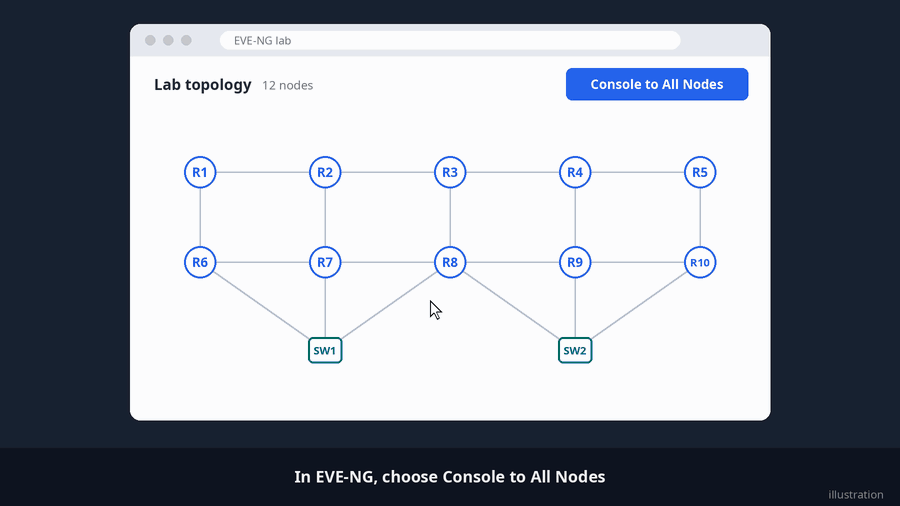

# EVE Windows Terminal

**Console to All Nodes in EVE-NG opens all nodes in tabs, alphabetically sorted, in the native Windows Terminal.**



*An illustration of what the tool does. It is a drawing, not a screen recording.*

Each tab is named after its node, and the tabs are in name order the way you'd expect: R1, R2 ... R10, SW1. Clicking a single node adds its console as a tab in the same window.

It runs in Windows Terminal, the terminal built into Windows 11, so there is no PuTTY, SecureCRT or other terminal to install. On Windows 10, Windows Terminal is a free install from the Microsoft Store.

It is the `telnet://` handler for Windows 10 and 11: two small native programs (C++ / Win32) and an installer. There is no runtime to install, and it needs neither PowerShell nor the Windows Telnet Client.

## Why

EVE-NG's native console links are `telnet://host:port` URLs. PuTTY, the handler from the EVE-NG Windows client pack, opens each console in its own window, so a ten-node lab means ten windows. Windows Terminal could hold them all as tabs, but the links carry only a host and port. A plain handler can't tell which node a link is for, so it can't name or sort the tabs.

## What it does

| Program | Role |
|---|---|
| `evewt.exe` | The `telnet://` handler. It has no window, so nothing flashes. It checks the link and opens a tab in the Windows Terminal window named `eve`. Links that arrive together (Console to All Nodes) open as tabs sorted by node name. |
| `evewt-console.exe` | The telnet client in each tab. It presses Enter once on connect, so the prompt (`R4>`) shows right away. Arrow keys recall command history, Ctrl+C reaches the router, and the node name EVE-NG sends becomes the tab title. If the node stops or reloads, the tab stays open as `[closed] R1` and Enter reconnects. |

## Requirements

- Windows 10 or 11, 64-bit.
- Windows Terminal. It comes with Windows 11. On Windows 10, install it from the Microsoft Store or with `winget install Microsoft.WindowsTerminal`.
- EVE-NG with **Native console** chosen on the login page. The HTML5 console runs in the browser and doesn't use `telnet://` links.

Only telnet consoles are handled. Nodes whose console is VNC or RDP still open in their usual client.

## Install

1. Download `EVE-Windows-Terminal-<version>.msi` from the [latest release](https://github.com/egrisdev/eve_native_terminal/releases/latest) and run it. The installer isn't code-signed, so Windows SmartScreen may say it "prevented an unrecognized app from starting". Choose **More info > Run anyway**, or [build it yourself](#building-from-source). Accept the UAC prompt. It installs to `C:\Program Files\EVE-WT` and replaces any older version in place, even while console tabs are open.
2. Windows doesn't let installers choose default apps. Right after the install, a message box appears and **Settings > Default apps** opens. Set **TELNET** to **EVE Windows Terminal**. On Windows 10 that's *Choose default apps by protocol* > TELNET. This step is skipped if TELNET is already set to it.
3. Restart the browser. In Firefox, check that Settings > General > Applications > `telnet` uses the system default. It should now show as *EVE Windows Terminal*.

Step 2 is per Windows account. To redo it at any time, for example for a second account, run `"C:\Program Files\EVE-WT\evewt.exe" --setup`.

## Uninstall

Go to **Settings > Apps > Installed apps > EVE Windows Terminal > Uninstall**. If TELNET was set to this app, uninstalling clears that choice, so telnet links go back to the system handler (PuTTY from the EVE-NG client pack, if it's installed).

## Keys in a console tab

| Key | Sends |
|---|---|
| Up / Down | Previous / next command (`ESC [A` / `ESC [B`, like PuTTY) |
| Left / Right, Home, End, Delete | The standard VT sequences PuTTY sends |
| Ctrl+C, Ctrl+Z, Ctrl+Shift+6 | Passed to the device. Ctrl+C doesn't close the tab. |
| Alt+B / Alt+F | `ESC b` / `ESC f`: back / forward one word in IOS |
| Enter in a `[closed]` tab | Reconnects. Ctrl+C there closes the tab. |

## How the tabs get sorted

EVE-NG's links carry only host and port. The node name arrives inside the session, as the terminal title EVE-NG sends on connect. So when several links arrive together:

1. The first `evewt.exe` waits until no new link has arrived for 0.5 s (3 s at most), collecting the others. They hand over their link and exit.
2. It connects to every console at once and reads each node's name. This usually takes a few tens of milliseconds, with a 1.5 s cap. Then it hangs up, so consoles that take one client at a time are free again for the tab.
3. It opens all the tabs with a single Windows Terminal command, in natural order (R2 before R10). Any node whose name didn't arrive goes at the end, by port.

A single console click also waits the 0.5 s, in case more links follow. Up to 64 consoles are sorted together. Any beyond that open on their own.

## Troubleshooting

- **Still opens PuTTY:** check that TELNET in Settings > Default apps shows *EVE Windows Terminal*. Then check the Firefox setting in [install step 3](#install).
- **Some consoles don't open with Console to All Nodes:** allow pop-ups for the EVE-NG site in your browser.
- **A tab is named `host:port` instead of the node:** that console didn't send a title on connect. It works normally, and with Console to All Nodes it is sorted last, by port.
- **Try one console by hand:** run `"C:\Program Files\EVE-WT\evewt-console.exe" eve.local 32769` in any Windows Terminal tab, with your EVE-NG host and the node's port.
- **Two "eve" windows:** the handler hands links to Windows Terminal one batch at a time so this doesn't happen. If it still does, [open an issue](https://github.com/egrisdev/eve_native_terminal/issues) with the number of nodes you opened and your Windows and Windows Terminal versions.

## Security

Any web page can fire a `telnet://` link, not only EVE-NG. So `evewt.exe` accepts only a plain host name or IP address and a numeric port. Anything else gets an error box instead of a tab. Telnet itself isn't encrypted, so keep EVE-NG consoles on a network you trust. [SECURITY.md](SECURITY.md) has the details and explains how to report a vulnerability.

## Building from source

Everything builds on Linux (Debian or Ubuntu), cross-compiling with mingw-w64:

```bash
sudo apt install g++ g++-mingw-w64-x86-64 wixl
./build.sh           # tests + both exes + MSI  -> dist/EVE-Windows-Terminal-1.1.2.msi
./build.sh 1.2.0     # build another version (needed for an MSI upgrade to replace the old one)
```

`build.sh` runs the unit tests natively, cross-compiles both exes into `build/`, and packages the MSI with wixl. The exes are statically linked, so they need no runtime DLLs. Both compilers run with `-Wall -Wextra -Werror`, so a warning fails the build.

Each build gets a new product code. An MSI rebuilt at the version that is already installed can install next to it instead of replacing it, so pass a higher version or uninstall the old one first.

The [Build workflow](.github/workflows/build.yml) does the same on every push and pull request. Pushing a tag like `v1.2.0` also publishes the installer as a GitHub Release.

### Layout

| Path | Contents |
|---|---|
| `src/core.h` | Portable core: `telnet://` URL validation, the telnet protocol (option negotiation, terminal type; window size is deliberately not sent), node-name detection and sorting. Unit-tested on any OS. |
| `src/evewt.cpp` | The `telnet://` handler (GUI subsystem). |
| `src/evewt-console.cpp` | The console telnet client. |
| `src/evewt.rc`, `src/evewt.manifest`, `eve-wt.ico` | Icon, version info and manifest for both exes. |
| `tests/core_test.cpp` | Unit tests for `src/core.h`. |
| `EVE-WT.wxs` | Installer definition (wixl / WiX v3 syntax). |
| `build.sh` | Tests, cross-build and packaging. |
| `.github/workflows/build.yml` | Runs `build.sh` on every push and pull request, and publishes a release for a version tag. |
| `docs/demo.gif`, `tools/make-demo.py` | The animation at the top of this page, and the script that draws it. |

### Tests

```bash
mkdir -p build && g++ -std=c++17 -Wall -Wextra -Werror -O1 -Isrc tests/core_test.cpp -o build/core_test && build/core_test
```

This needs only `g++`. The tests cover `src/core.h`: URL validation, the telnet protocol, UTF-8 splitting, title detection and natural sorting. The two Windows programs have no automated tests and are checked by hand on Windows.

## Disclaimer

EVE Windows Terminal is a free, unofficial, community tool. It is provided **"as is", without warranty of any kind**, and the authors accept **no liability** for any damage, data loss, security incident or other harm that comes from using it (see the [license](LICENSE)). Review the code and test it before relying on it, and follow your organization's security policies.

Product names mentioned here (EVE-NG, Windows, Windows Terminal, PuTTY, SecureCRT, Firefox, Cisco IOS and so on) are trademarks of their owners and are used only to describe compatibility. EVE Windows Terminal is not affiliated with or endorsed by any of them.

## License

EVE Windows Terminal is released under the [MIT License](LICENSE): anyone may use, copy, modify and distribute it, commercially or not, for any purpose. The only condition is keeping the copyright and license notice.
